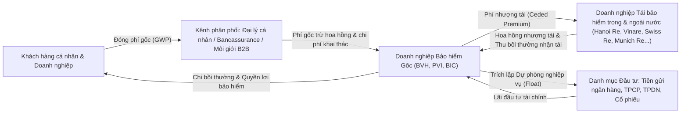

# Hồ sơ ngành Bảo hiểm Việt Nam — Cấu trúc cạnh tranh, Kinh tế đơn vị và Chu kỳ vốn (VN-insurance)

- Chốt dữ liệu lúc: `2026-11-05 11:20 Asia/Ho_Chi_Minh`
- Quốc gia / thị trường / phạm vi: `Việt Nam / Bảo hiểm Nhân thọ, Phi nhân thọ và Tái bảo hiểm / HOSE, HNX, UPCoM`
- Chuẩn kế toán và pháp lý: `VAS (Thông tư 232/2012/TT-BTC, Thông tư 199/2014/TT-BTC); Luật Kinh doanh bảo hiểm (31/VBHN-VPQH); Nghị định 46/2023/NĐ-CP; Thông tư 67/2023/TT-BTC (44/VBHN-BTC)`
- Tiền tệ / đơn vị báo cáo: `VND; bảng dưới tính bằng tỷ VND nếu không ghi khác`
- Đề bài nghiên cứu: [Đợt 3 — Ngành Bảo hiểm Việt Nam và ba hồ sơ mẫu BVH, PVI, BIC](../../briefs/vn-insurance-sector-and-profiles-2026-11-05.md)
- Sổ nguồn: [source-register.md](source-register.md)
- Kiểm nguồn: `ĐẠT`
- Phản biện rủi ro: `ĐẠT`

## Tóm tắt bài học

Ngành bảo hiểm Việt Nam vận hành trên chu kỳ vốn đảo ngược: doanh nghiệp thu phí trước, lập dự phòng kỹ thuật (`Technical Reserves`) và đầu tư nguồn vốn tạm thời nhàn rỗi (`Float`) trước khi bồi thường hoặc chi trả quyền lợi xảy ra. Giai đoạn 2023–2025 đánh dấu cuộc thanh lọc pháp lý sâu sắc nhất trong hai thập kỷ qua sau khủng hoảng niềm tin kênh phân phối qua ngân hàng (`Bancassurance`). Việc thực thi Luật Kinh doanh bảo hiểm năm 2022 (hợp nhất tại `31/VBHN-VPQH`), Nghị định `46/2023/NĐ-CP` và Thông tư `67/2023/TT-BTC` (hợp nhất tại `44/VBHN-BTC`) đã tạo ra sự phân hóa rõ rệt giữa hai khối: khối nhân thọ thu hẹp khai thác mới để làm sạch chất lượng đại lý, trong khi khối phi nhân thọ tiếp tục tăng trưởng hai chữ số nhờ nhu cầu bảo hiểm sức khỏe, tài sản công nghiệp và xe cơ giới.

Đặt cạnh ba doanh nghiệp niêm yết đại diện cho ba mô hình kinh doanh khác nhau trong năm tài chính 2025 đã kiểm toán — Tập đoàn Bảo Việt ([`BVH`](../../companies/VN/BVH/report.md)), CTCP PVI ([`PVI`](../../companies/VN/PVI/report.md)) và Tổng Công ty Bảo hiểm BIDV ([`BIC`](../../companies/VN/BIC/report.md)) — người đọc sẽ thấy **không thể dùng chung một bộ chỉ số để chấm điểm mọi công ty bảo hiểm**:
1. Với doanh nghiệp hỗn hợp nặng về nhân thọ như `BVH`, biến số sinh tử là **chênh lệch giữa lợi suất đầu tư danh mục trái phiếu/tiền gửi và lãi suất cam kết tối thiểu của hợp đồng cũ**, cùng đệm an toàn vốn (`107%` ở mảng nhân thọ).
2. Với nhà bảo hiểm công nghiệp kiêm tái bảo hiểm như `PVI`, biến số quyết định là **tỷ lệ giữ lại (`32,39%`), chất lượng tín dụng đối tác nhận tái bảo hiểm (khi tài sản tái bảo hiểm gấp `2,53 lần` vốn chủ sở hữu) và hoa hồng nhượng tái**.
3. Với nhà bảo hiểm phi nhân thọ bán lẻ qua ngân hàng mẹ như `BIC`, biến số trọng tâm là **tỷ lệ kết hợp (`Combined Ratio` đạt `84,17%` trước hoa hồng nhượng tái), chi phí hoa hồng trả cho ngân hàng mẹ (`BIDV`) và độ nhạy thiên tai bão lũ theo quý**.

## Chuỗi giá trị và phạm vi ngành

`SỰ_THẬT` Theo Luật Kinh doanh bảo hiểm hợp nhất số `31/VBHN-VPQH` (hợp nhất Luật số `08/2022/QH15` và Luật số `56/2024/QH15`), hoạt động kinh doanh bảo hiểm tại Việt Nam được chia thành ba lĩnh vực cốt lõi: **Bảo hiểm nhân thọ** (trường hợp sống, tử kỳ, sinh kỳ, hỗn hợp, trọn đời, niên kim, liên kết đầu tư, hưu trí), **Bảo hiểm phi nhân thọ** (tài sản, hàng hóa vận chuyển, hàng không, xe cơ giới, cháy nổ, thân tàu và trách nhiệm dân sự chủ tàu, trách nhiệm, tín dụng và rủi ro tài chính, thiệt hại kinh doanh, nông nghiệp) và **Bảo hiểm sức khỏe** (tai nạn con người, y tế, chăm sóc sức khỏe) [S1]. Về mặt tổ chức pháp nhân, Luật nghiêm cấm một doanh nghiệp kinh doanh đồng thời bảo hiểm nhân thọ và bảo hiểm phi nhân thọ (trừ trường hợp doanh nghiệp bảo hiểm nhân thọ kinh doanh thêm nghiệp vụ bảo hiểm sức khỏe); do đó các tập đoàn như Bảo Việt (`BVH`) phải vận hành qua mô hình công ty mẹ (holding) nắm hai tổng công ty con độc lập là Tổng Công ty Bảo Việt Nhân thọ và Tổng Công ty Bảo hiểm Bảo Việt [S1, S5].

`SỰ_THẬT` (thứ cấp, dẫn theo thống kê của Cục Quản lý, giám sát bảo hiểm — Bộ Tài chính) Quy mô tổng doanh thu phí bảo hiểm toàn thị trường Việt Nam năm 2025 đạt khoảng **233.112 đến 237.211 tỷ VND** (tăng khoảng `2,56%–3,96%` so với năm 2024 tùy thời điểm chốt bản tin ước tính và tổng kết năm), trong đó:
- **Khối bảo hiểm nhân thọ:** doanh thu phí ước đạt **145.085 đến 148.786 tỷ VND** (chiếm khoảng `62,2%–62,7%` toàn thị trường), giảm nhẹ khoảng `1,94%` hoặc đi ngang so với năm 2024 do quá trình tái cấu trúc kênh đại lý và bancassurance [S4].
- **Khối bảo hiểm phi nhân thọ:** doanh thu phí bảo hiểm gốc ước đạt **88.054 đến 88.425 tỷ VND** (chiếm khoảng `37,3%–37,8%` toàn thị trường), tăng trưởng `10,95%` so với năm 2024 nhờ động lực từ bảo hiểm sức khỏe, bảo hiểm xe cơ giới và bảo hiểm tài sản - kỹ thuật [S4].

*Giới hạn nguồn ngành:* Các con số tổng hợp toàn ngành năm 2025 nói trên được dẫn qua cổng thông tin Bộ Tài chính và bản tin tổng hợp của doanh nghiệp/hiệp hội (`thứ cấp`); chưa tải được tệp Niên giám Thống kê Thị trường Bảo hiểm năm 2025 bản đầy đủ dạng bảng chi tiết từng công ty từ Cục Quản lý, giám sát bảo hiểm (`CHƯA_BIẾT`). Do đó, mọi kết luận định lượng cấp độ doanh nghiệp trong báo cáo này đều được neo trực tiếp vào **BCTC hợp nhất năm 2025 đã kiểm toán** của `BVH`, `PVI` và `BIC` [S5, S6, S7].

## Cú sốc thể chế 2023–2025 và rào cản gia nhập ngành

`SỰ_THẬT` Ba văn bản pháp quy định hình lại cuộc chơi của ngành bảo hiểm Việt Nam từ năm 2023 đến nay gồm:
1. **Vốn pháp định tối thiểu (Điều 35 Nghị định `46/2023/NĐ-CP`) [S2]:**
   - Doanh nghiệp bảo hiểm phi nhân thọ: từ **400 tỷ VND** (kinh doanh bảo hiểm phi nhân thọ và sức khỏe) đến **450 tỷ VND** (có thêm hàng không hoặc vệ tinh) và **500 tỷ VND** (có cả hàng không và vệ tinh).
   - Doanh nghiệp bảo hiểm nhân thọ: **750 tỷ VND** (nhân thọ cơ bản và sức khỏe), **1.000 tỷ VND** (kinh doanh thêm bảo hiểm liên kết đơn vị hoặc bảo hiểm hưu trí) và **1.300 tỷ VND** (kinh doanh cả bảo hiểm liên kết đơn vị và bảo hiểm hưu trí).
   - Doanh nghiệp tái bảo hiểm: từ **500 tỷ VND** (tái phi nhân thọ hoặc cả hai loại hình tái phi nhân thọ và tái sức khỏe), **900 tỷ VND** (tái nhân thọ hoặc cả hai loại hình tái nhân thọ và tái sức khỏe) đến **1.400 tỷ VND** (kinh doanh cả 03 loại hình tái bảo hiểm) (Khoản 4 Điều 35 Nghị định `46/2023/NĐ-CP`) [S2, tr. 42].
2. **Trần hoa hồng đại lý và siết kênh Bancassurance (Thông tư `67/2023/TT-BTC`, hợp nhất tại `44/VBHN-BTC` và Nghị định `46/2023/NĐ-CP`) [S2, S3]:**
   - **Điều 51 `44/VBHN-BTC` (Hoa hồng đại lý tối đa):** Đối với các hợp đồng bảo hiểm mới phát hành từ ngày `01/07/2024` trở đi, cả hai dòng sản phẩm **bảo hiểm liên kết chung (`Universal Life — UL`) và bảo hiểm liên kết đơn vị (`Unit-Linked`)** nộp phí định kỳ đều có trần hoa hồng năm hợp đồng thứ nhất là **30%** (năm thứ hai **20%**, các năm tiếp theo **10%**; nộp phí một lần là **7%**); với bảo hiểm tử kỳ và sức khỏe là **40%** và **20%** [S3, tr. 65–66].
   - **Điều 53 `44/VBHN-BTC` & Điểm e Khoản 1 Điều 62 Nghị định `46/2023/NĐ-CP` (Quy tắc Bancassurance):** Cấm tổ chức tín dụng tư vấn, giới thiệu, chào bán bảo hiểm liên kết đầu tư cho khách hàng trong thời hạn **60 ngày trước và 60 ngày sau** ngày giải ngân toàn bộ khoản vay; bắt buộc **ghi âm** toàn bộ quá trình tư vấn sản phẩm liên kết đầu tư và lưu trữ tối thiểu **5 năm** (Điều 53 `44/VBHN-BTC`); tại mỗi chi nhánh/phòng giao dịch ngân hàng phải thiết lập quầy tư vấn bảo hiểm riêng biệt, tách khỏi khu vực giao dịch tín dụng/tiền gửi (Điểm e Khoản 1 Điều 62 Nghị định `46/2023/NĐ-CP`) [S2, tr. 69; S3, tr. 68–70].
3. **Lộ trình chuyển đổi sang Mô hình vốn trên cơ sở rủi ro (`Risk-Based Capital — RBC`, Điều 156 Luật Kinh doanh bảo hiểm `31/VBHN-VPQH`) [S1]:**
   - Trong giai đoạn chuyển tiếp 5 năm kể từ ngày Luật có hiệu lực (`01/01/2023` đến hết `31/12/2027`), các doanh nghiệp vẫn áp dụng cơ chế biên khả năng thanh toán tối thiểu theo công thức cố định (`Solvency I`), nhưng từ ngày **`01/01/2028`** toàn ngành bắt buộc phải áp dụng mô hình **Vốn trên cơ sở rủi ro (`RBC`)**, tính yêu cầu vốn theo cả rủi ro bảo hiểm, rủi ro thị trường (lãi suất, cổ phiếu, tỷ giá), rủi ro tín dụng đối tác và rủi ro hoạt động [S1].

`SUY_LUẬN` Sự kết hợp giữa quy định cấm bán kèm khoản vay trong cửa sổ `±60 ngày` và lộ trình `RBC 2028` làm tăng đáng kể chi phí tuân thủ, triệt tiêu mô hình tăng trưởng nóng dựa trên ép mua bảo hiểm kèm giải ngân tín dụng, đồng thời buộc các doanh nghiệp có biên khả năng thanh toán mỏng hoặc tăng trưởng nhận tái bảo hiểm nhanh phải tăng vốn chủ sở hữu trước năm 2028.

## Kinh tế đơn vị và so sánh trực diện 3 mô hình kinh doanh (`BVH`, `PVI`, `BIC`)

`SỰ_THẬT` và `PHÉP_TÍNH` Bảng dưới đây tổng hợp và chuẩn hóa số liệu từ BCTC hợp nhất năm 2025 đã kiểm toán của ba doanh nghiệp tiêu biểu ngành bảo hiểm Việt Nam (mọi phép tính được kiểm thử tự động trong [`calc_insurance_profiles.py`](../../companies/VN/calc_insurance_profiles.py)):

| Chỉ tiêu (FY2025 hợp nhất đã kiểm toán) | Tập đoàn Bảo Việt (`BVH`) [S5] | CTCP PVI (`PVI`) [S6] | Bảo hiểm BIDV (`BIC`) [S7] | Ý nghĩa kinh tế / Bài học phân tích |
|---|---:|---:|---:|---|
| **Mô hình kinh doanh cốt lõi** | Tập đoàn Nhân thọ (`74,7%` phí gốc) + Phi nhân thọ (`25,3%`) | Phi nhân thọ bán buôn công nghiệp + Tái bảo hiểm (`Hanoi Re`) | Phi nhân thọ bán lẻ & `Bancassurance` qua ngân hàng mẹ `BIDV` | Ba cấu trúc bảng cân đối và báo cáo KQKD hoàn toàn khác nhau |
| **Tổng tài sản cuối năm 2025 (tỷ VND)** | `291.805,65` (`+16,12%`) | `44.512,14` (`+40,00%`) | `10.092,71` (`+16,24%`) | `BVH` có quy mô tài sản gấp `6,56 lần` `PVI` và `28,91 lần` `BIC` do tích lũy dự phòng nhân thọ dài hạn |
| **Đầu tư tài chính thuần cuối năm (tỷ VND / % Tài sản)** | `266.535,57` (`91,34%`) | `16.707,55` (`37,53%`) | `7.221,63` (`71,55%`) | `PVI` có tỷ trọng đầu tư tài chính trên tổng tài sản thấp vì `48,56%` tài sản nằm ở khoản phải thu/dự phòng nhượng tái bảo hiểm |
| **Tài sản tái bảo hiểm (tỷ VND / so với Vốn chủ)** | `3.682,41` (`0,14x` VCSH) | `21.614,45` (`2,53x` VCSH) | `1.628,70` (`0,48x` VCSH) | Điểm nghẽn rủi ro đối tác lớn nhất của `PVI`: tài sản tái bảo hiểm gấp `2,53 lần` tổng vốn chủ sở hữu |
| **Dự phòng nghiệp vụ gộp / Dự phòng giữ lại ròng (tỷ VND)** | `201.682,49` / `198.000,08` | `28.417,50` / `6.803,05` | `4.454,52` / `2.825,82` | `BVH` giữ lại `98,17%` dự phòng; `PVI` chuyển phần lớn dự phòng sang nhà nhận tái bảo hiểm |
| **Tổng vốn chủ sở hữu / Vốn chủ công ty mẹ (tỷ VND)** | `25.480,34` / `24.451,17` | `8.533,91` / `8.183,98` | `3.383,09` / `3.250,06` | Tỷ lệ đòn bẩy `Tài sản / VCSH`: `BVH` `11,45x`; `PVI` `5,22x`; `BIC` `2,98x` |
| **Doanh thu phí bảo hiểm gốc `GWP` (tỷ VND, % YoY)** | `43.716,18` (`+2,64%`) | `14.908,34` (`+11,52%`) | `5.702,42` (`+4,83%`) | `PVI` dẫn đầu thị phần phi nhân thọ gốc (`14.908,34 tỷ`), vượt mảng phi nhân thọ của `BVH` (`11.074,40 tỷ`) |
| **Phí nhận tái bảo hiểm `Inward` (tỷ VND, % YoY)** | `399,97` (`+32,20%`) | `10.498,98` (`+82,87%`) | `92,49` (`-29,88%`) | `PVI` đẩy mạnh nhận tái bảo hiểm quốc tế/trong nước qua `PVI Insurance` và `Hanoi Re` |
| **Phí nhượng tái bảo hiểm `Ceded` (tỷ VND)** | `-3.808,52` | `-17.178,02` | `-1.762,17` | `PVI` nhượng tái `17.178,02 tỷ`, lớn hơn cả tổng doanh thu phí bảo hiểm gốc của chính mình |
| **Phí giữ lại thuần `NWP` (tỷ VND) & Tỷ lệ giữ lại (`Retention`)** | `40.307,63` (`91,37%`) | `8.229,30` (`32,39%`) | `4.032,75` (`69,59%`) | Phản ánh sự đối lập giữa bảo hiểm nhân thọ (`91,37%`), bán lẻ phi nhân thọ (`69,59%`) và bán buôn dự án lớn (`32,39%`) |
| **Phí bảo hiểm thuần được hưởng `NEP` (tỷ VND)** | `40.123,67` | `7.633,90` | `3.948,01` | Mẫu số chuẩn để đo tỷ lệ bồi thường và tỷ lệ chi phí khai thác |
| **Hoa hồng nhượng tái & thu khác HĐBH (tỷ VND)** | `824,59` | `1.707,41` | `338,30` | Với `PVI`, hoa hồng nhượng tái (`1.337,61 tỷ`) + thu phí khác (`369,80 tỷ`) bằng `22,37%` `NEP`! |
| **Tỷ lệ bồi thường giữ lại (`Loss Ratio` trên `NEP`)** | Không tách ngang bằng PNT (chi trả + dự phòng nhân thọ = `87,54%` `NEP`) | `43,05%` | `30,14%` (gồm trích dao động lớn) | `BIC` có `Loss Ratio` thấp nhất nhờ tỷ trọng bảo hiểm sức khỏe/tai nạn người vay (`41,35%` `GWP`), nhưng chi phí hoa hồng/khai thác cao |
| **Tỷ lệ kết hợp (`Combined Ratio`) trước / sau hoa hồng nhượng tái** | Không áp dụng gộp chung nhân thọ (Lợi nhuận gộp HĐBH `+1.237,95 tỷ`) | `117,02%` / `99,50%` (tính cả G&A; nếu chưa tính G&A là `106,06%` / `88,54%`) | `84,17%` / `75,60%` (chưa gồm G&A; nếu tính cả G&A `800,17 tỷ` là `104,44%` / `95,87%`) | Cho thấy tầm quan trọng của việc **nêu rõ định nghĩa công thức**: có trừ hoa hồng nhượng tái và có cộng chi phí quản lý doanh nghiệp (`G&A`) hay không! |
| **Lợi nhuận hoạt động tài chính thuần (tỷ VND)** | `11.120,47` (`+5,17%`) | `918,21` (`+3,92%`) | `511,28` (`+36,96%`) | Cỗ máy tạo lợi nhuận thực sự cho cả ba doanh nghiệp đều nằm ở danh mục đầu tư `Float` |
| **Lợi nhuận trước thuế `EBT` / Sau thuế `NPAT` (tỷ VND)** | `3.554,43` / `2.921,57` (`+33,15%`) | `1.459,67` / `1.152,11` (`+29,27%`) | `678,93` / `550,53` (`+9,88%`) | Cả ba đều tăng trưởng lợi nhuận sau thuế hai chữ số hoặc sát `10%` trong năm 2025 |
| **ROE công ty mẹ bình quân (`NPAT mẹ / VCSH mẹ bình quân`)** | `12,06%` | `13,77%` | `17,51%` | `BIC` dẫn đầu về `ROE` nhờ đòn bẩy khai thác bán lẻ lãi cao và cấu trúc vốn gọn nhẹ |
| **Tỷ lệ biên khả năng thanh toán cuối năm 2025 (`Solvency Margin`)** | Nhân thọ: **`107%`** (`2024: 104%`); Phi nhân thọ: **`141%`** (`2024: 145%`) | Không công bố bảng hợp nhất; `PVI Insurance` tăng vốn điều lệ lên `4.320 tỷ` (T9/2025) và `5.000 tỷ` (T1/2026) | **`285%`** (`284,67%`, tăng từ `249%` năm 2024 trình bày lại) | `BVH` Nhân thọ (`107%`) chỉ đứng cách ngưỡng cảnh báo can thiệp sớm (`100%`) đúng `7 điểm phần trăm`, trái ngược với đệm vốn rất dày của `BIC` (`285%`) |

### So sánh với chuẩn mực toàn cầu: Berkshire Hathaway (`GEICO` & `BHRG`)

`SỰ_THẬT` và `PHÉP_TÍNH` Để đặt ngành bảo hiểm Việt Nam trong hệ quy chiếu toàn cầu, ta đối chiếu với Báo cáo thường niên năm 2025 của **Berkshire Hathaway Inc.** (Mỹ, chuẩn `US GAAP`, đơn vị triệu USD) [S8]:
- Mảng bảo hiểm xe cơ giới bán lẻ trực tiếp **`GEICO`** năm 2025 đạt doanh thu phí được hưởng (`NEP`) **44.481 triệu USD** (phí phát hành `45.193 triệu USD`), chi bồi thường (`Losses & LAE`) **32.144 triệu USD** (`Loss Ratio = 72,26%`, báo cáo làm tròn `72,3%`), chi phí khai thác và quản lý (`Underwriting expenses`) **5.513 triệu USD** (`Expense Ratio = 12,39%`, báo cáo làm tròn `12,4%`), mang lại **`Combined Ratio = 84,66%`** (`84,7%`) và lợi nhuận khai thác thuần trước thuế **6.824 triệu USD** [S8, tr. K-36].
- Tổng nguồn vốn `Float` bảo hiểm của toàn tập đoàn Berkshire Hathaway đạt **176 tỷ USD** cuối năm 2025 với chi phí vốn âm (lãi khai thác bảo hiểm tổng hợp sau thuế đạt **7.258 triệu USD**) [S8, tr. K-35, K-41].

`SUY_LUẬN` Khi đặt `GEICO` (`Loss Ratio 72,26%`, `Expense Ratio 12,39%`) cạnh các doanh nghiệp phi nhân thọ Việt Nam như `BIC` (`Loss Ratio 30,14%`, `Direct UW Expense Ratio 54,03%` trước G&A) hay `PVI` (`Loss Ratio 43,05%`, `Direct UW Expense Ratio 63,01%` trước G&A), ta phát hiện một nghịch lý cấu trúc rất đặc trưng của thị trường mới nổi:
1. **Ở Mỹ (`GEICO`), phần lớn mỗi đồng phí thu được dùng để trả tiền bồi thường cho khách hàng (`~72%`), còn chi phí trung gian/bán hàng cực thấp (`~12,4%`) nhờ bán trực tuyến.**
2. **Ở Việt Nam, tỷ lệ chi bồi thường giữ lại trên báo cáo rất thấp (`30%–43%`), nhưng chi phí hoa hồng, thưởng hỗ trợ đại lý, tiếp thị và quản lý đại lý ngốn từ `54%` đến trên `70%` phí giữ lại!** Nói cách khác, cuộc chiến cạnh tranh trong ngành bảo hiểm phi nhân thọ Việt Nam hiện nay là **cuộc chiến giành kênh phân phối (ngân hàng, đại lý ô tô, môi giới dự án)** chứ chưa phải là cuộc chiến tối ưu hóa chi phí vận hành trực tuyến cho người mua cuối cùng.

## Động lực vĩ mô, chu kỳ lãi suất và rủi ro toàn ngành

1. **Độ nhạy lãi suất hai chiều (`Interest Rate Convexity`):**
   - `SỰ_THẬT` Đối với doanh nghiệp phi nhân thọ (`PVI`, `BIC`), kỳ hạn nợ dự phòng ngắn (dưới 1 năm) trong khi danh mục đầu tư chủ yếu là tiền gửi có kỳ hạn từ 3 tháng đến 2 năm. Tại ngày `31/12/2025`, `BIC` nắm **5.622,31 tỷ VND** tiền gửi có kỳ hạn (`77,85%` danh mục đầu tư) hưởng lãi suất tới `10,35%–12,8%/năm` [S7, tr. 36–38]. Khi lãi suất tiền gửi nhích lên, lợi nhuận tài chính của khối phi nhân thọ tăng gần như tức thì.
   - `SỰ_THẬT` Ngược lại, với doanh nghiệp nhân thọ (`BVH`), thuyết minh 24 (trang 61–64 BCTC hợp nhất 2025) cho thấy `BVH` đang gánh **171.409,33 tỷ VND** dự phòng toán học và **16.544,35 tỷ VND** dự phòng đảm bảo lãi suất cam kết tối thiểu [S5]. Trong năm 2024, khi mặt bằng lãi suất chiết khấu thấp, `BVH` phải trích lập thêm **3.081,91 tỷ VND** vào quỹ dự phòng đảm bảo lãi suất tối thiểu, đẩy hoạt động kinh doanh bảo hiểm hợp nhất lỗ gộp **`-969,11 tỷ VND`**; sang năm 2025, khi lợi suất trái phiếu Chính phủ kỳ hạn dài nhích tăng nhẹ, `BVH` được hoàn nhập **`+197,39 tỷ VND`** khoản dự phòng này, giúp lợi nhuận gộp bảo hiểm đảo chiều dương **`+1.237,95 tỷ VND`** (chênh lệch **`+2.207,06 tỷ VND`** giữa hai năm!) [S5, tr. 11, 61, 71].
2. **Rủi ro thiên tai và biến đổi khí hậu (`Catastrophe Risk`):**
   - `SỰ_THẬT` Năm 2024 (siêu bão Yagi) và Quý 4/2025 (đợt mưa bão, lũ lụt diện rộng tại miền Trung và miền Bắc) đã kiểm chứng mức độ tổn thương của mảng bảo hiểm tài sản, kỹ thuật và xe cơ giới. Theo Công văn giải trình `156/CV-KT` ngày `30/01/2026` của `BIC`, lợi nhuận gộp kinh doanh bảo hiểm Quý 4/2025 của `BIC` sụt giảm **`-58,70%`** (từ `463,35 tỷ VND` Quý 4/2024 xuống `191,37 tỷ VND` Quý 4/2025) do chi phí bồi thường bão lũ tăng cao [S7b, tr. 8, 22]. Tại `PVI`, dự phòng bồi thường ngắn hạn gộp cuối năm 2025 tăng vọt từ `9.579,22 tỷ VND` lên **`18.126,64 tỷ VND`** (`+89,23%`), trong đó phần gánh chịu của nhà nhận tái bảo hiểm tăng từ `7.518,47 tỷ VND` lên **`15.368,84 tỷ VND`** (`+104,41%`) [S6, tr. 32, 42].
3. **Chu kỳ cứng hóa phí tái bảo hiểm quốc tế (`Hardening Reinsurance Cycle`):**
   - `SUY_LUẬN` Khi các nhà nhận tái bảo hiểm quốc tế phải gánh hàng nghìn tỷ đồng bồi thường thiên tai và cháy nổ công nghiệp tại Việt Nam trong hai năm 2024–2025, kỳ tái tục hợp đồng tái bảo hiểm cố định (`Treaty Renewal`) giai đoạn 2026–2027 sẽ đối mặt với áp lực tăng phí nhượng tái, siết điều khoản loại trừ thiên tai hoặc cắt giảm tỷ lệ hoa hồng nhượng tái (`Ceding Commission`). Các doanh nghiệp phụ thuộc lớn vào hoa hồng nhượng tái như `PVI` sẽ chịu tác động trực tiếp nếu tỷ lệ hoa hồng nhượng tái giảm từ `2–3 điểm phần trăm`.

## Điều kiện làm luận điểm ngành mất hiệu lực

Luận điểm cơ sở rằng *"Ngành bảo hiểm Việt Nam đang bước vào chu kỳ phục hồi chất lượng lợi nhuận sau giai đoạn thanh lọc pháp lý 2023–2025"* sẽ mất hiệu lực nếu xảy ra một trong các điều kiện định lượng sau:
1. Lợi suất trái phiếu Chính phủ kỳ hạn 10–15 năm giảm sâu thêm trên `100 điểm cơ bản (1,0%)` và duy trì kéo dài, buộc khối nhân thọ (`BVH`) phải trích lập bổ sung hàng nghìn tỷ đồng dự phòng đảm bảo lãi suất tối thiểu và đẩy biên khả năng thanh toán mảng nhân thọ xuống dưới ngưỡng pháp định `100%`.
2. Tỷ lệ kết hợp sau hoa hồng nhượng tái (`Combined Ratio`) của các doanh nghiệp phi nhân thọ đầu ngành (`PVI`, `BIC`) vượt ngưỡng `100%` trong 2 năm liên tiếp do thiên tai bão lũ lặp lại kết hợp với việc nhà tái bảo hiểm quốc tế cắt giảm mạnh hoa hồng nhượng tái.
3. Phát sinh sự cố mất khả năng thanh toán hoặc tranh chấp pháp lý trọng yếu từ một đối tác nhận tái bảo hiểm nước ngoài hoặc từ danh mục trái phiếu doanh nghiệp/tiền gửi tại các định chế tài chính trong nước.

## Điều chưa biết và lần kiểm tra tiếp theo

- `CHƯA_BIẾT` Niên giám thống kê thị trường bảo hiểm năm 2025 bản chi tiết từng doanh nghiệp của Cục Quản lý, giám sát bảo hiểm (Bộ Tài chính) để đối chiếu chính xác thị phần phí gốc và biên khả năng thanh toán của toàn bộ 32 doanh nghiệp phi nhân thọ và 19 doanh nghiệp nhân thọ (hiện mới có số tổng hợp toàn ngành qua cổng thông tin Bộ Tài chính và số kiểm toán của các doanh nghiệp niêm yết).
- `CHƯA_BIẾT` Văn bản hướng dẫn chi tiết công thức tính hệ số rủi ro cụ thể cho mô hình `RBC` áp dụng từ `01/01/2028` theo Điều 156 Luật Kinh doanh bảo hiểm.
- **Lần kiểm tra tiếp theo:** Khi các doanh nghiệp công bố BCTC bán niên năm 2026 đã soát xét (tháng 08/2026) để kiểm tra: (1) tốc độ thu hồi khoản phải thu bồi thường nhượng tái bảo hiểm `15.368,84 tỷ VND` tại `PVI`; (2) biến động biên khả năng thanh toán mảng nhân thọ của `BVH` quanh mốc `107%`; và (3) diễn biến tỷ lệ bồi thường sau mùa mưa bão năm 2026.

## Sổ nguồn tóm tắt

Chi tiết đầy đủ xem tại [source-register.md](source-register.md).

| Mã | Nhận định / đầu vào | Nhãn | Nguồn | Ngày xuất bản | Kỳ báo cáo | Ngày truy cập | Đơn vị / tiền tệ | Phiên bản / ghi chú |
|---|---|---|---|---|---|---|---|---|
| S1 | Phân loại bảo hiểm, nguyên tắc tách pháp nhân nhân thọ/phi nhân thọ, lộ trình RBC 01/01/2028 | `SỰ_THẬT` | Văn bản hợp nhất Luật Kinh doanh bảo hiểm số 31/VBHN-VPQH | 2025 | Hiện hành | 2026-11-05 | Văn bản luật | Bản PDF Công báo Chính phủ |
| S2 | Vốn pháp định tối thiểu DNBH phi nhân thọ (400–500 tỷ), nhân thọ (750–1.300 tỷ), tái BH (500–1.400 tỷ) và quầy tư vấn riêng tại ngân hàng (Điều 35, Điều 62) | `SỰ_THẬT` | Nghị định 46/2023/NĐ-CP | 01/07/2023 | Hiện hành | 2026-11-05 | Tỷ VND | Bản PDF ký số Chính phủ |
| S3 | Trần hoa hồng đại lý UL & Unit-Linked năm đầu 30% (Điều 51) và quy tắc Bancassurance ±60 ngày, ghi âm 5 năm (Điều 53) | `SỰ_THẬT` | Thông tư 67/2023/TT-BTC (hợp nhất tại 44/VBHN-BTC) | 2025 | Hiện hành | 2026-11-05 | % phí bảo hiểm | Bản PDF Công báo Chính phủ |
| S4 | Tổng doanh thu phí toàn thị trường 2025 (~233.112–237.211 tỷ VND; nhân thọ ~145.085–148.786 tỷ; phi nhân thọ ~88.054–88.425 tỷ) | `SỰ_THẬT` (thứ cấp) | Cổng TTĐT Bộ Tài chính & tổng hợp thống kê Cục QLBH | 2026 | FY2025 | 2026-11-05 | Tỷ VND | Số ước tính/tổng hợp bản tin thị trường |
| S5 | Toàn bộ số liệu BCTC hợp nhất FY2025 đã kiểm toán của Tập đoàn Bảo Việt (`BVH`) | `SỰ_THẬT` | BCTC hợp nhất FY2025 đã kiểm toán của BVH (EY Việt Nam) | 31/03/2026 | FY2025 & FY2024 | 2026-11-05 | VND | 115 trang PDF; SHA-256 trong `data/raw/insurance-review-sources-2026-11-05.json` |
| S6 | Toàn bộ số liệu BCTC hợp nhất FY2025 đã kiểm toán của CTCP PVI (`PVI`) | `SỰ_THẬT` | BCTC hợp nhất FY2025 đã kiểm toán của PVI (PwC Việt Nam) | 15/02/2026 | FY2025 & FY2024 trình bày lại | 2026-11-05 | VND | 65 trang PDF; SHA-256 trong `data/raw/insurance-review-sources-2026-11-05.json` |
| S7 | Toàn bộ số liệu BCTC hợp nhất FY2025 đã kiểm toán của Tổng Công ty Bảo hiểm BIDV (`BIC`) | `SỰ_THẬT` | BCTC hợp nhất FY2025 đã kiểm toán của BIC (EY Việt Nam) | 20/03/2026 | FY2025 & FY2024 trình bày lại | 2026-11-05 | VND | 86 trang PDF; đối chiếu thêm BCTC Q4/2025 tự lập (S7b) |
| S8 | Số liệu đối chiếu quốc tế GEICO (`NEP 44.481 triệu USD`, `CR 84,66%`) và Float Berkshire (`176 tỷ USD`) | `SỰ_THẬT` | Berkshire Hathaway Inc. 2025 Annual Report (Form 10-K, tr. K-35, K-36, K-41) | 2026 | FY2025 | 2026-11-05 | Triệu USD / Tỷ USD | Tải trực tiếp từ `berkshirehathaway.com` |

## Biên bản kiểm duyệt

- Biên bản kiểm nguồn: [fact-check.md](fact-check.md)
- Biên bản phản biện rủi ro: [risk-review.md](risk-review.md)
- Bất đồng chưa giải quyết: `Không có`

> Chỉ dùng cho học tập và nghiên cứu. Đây không phải tư vấn tài chính cá nhân hay khuyến nghị giao dịch.
